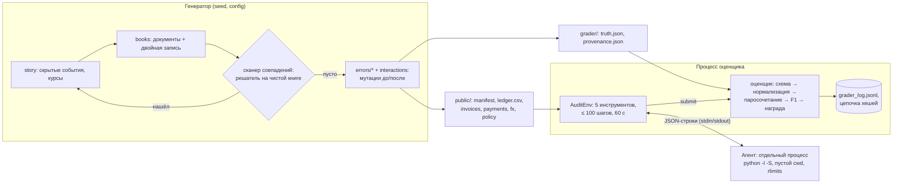

# AuditEnv — RL‑среда для ИИ‑аудитора (Genesis Hackathon, FinTech)

[](https://github.com/diawx-6669/XAZAYEVA-/actions/workflows/check.yml)

## Проверка за 5 минут

Три команды из корня репозитория (Python 3.11, без сети; с Docker — `make docker-check`, там то же самое):

```bash
make venv && make quick
```

Ожидаемо (~1 мин): строка pytest без `failed`, таблица `3 эпизода × 4 политики` и `quick smoke: …s`.

```bash
python -m auditenv run --policy simple_reconcile --seed 12 --config dev-mixed
```

Ожидаемо (~2 с): `{"episode_id": "ep-y2r4r23pqg", "tp": 2, "fp": 0, "fn": 1, "f1": 0.8, "reward": 0.574, "steps": 14}` —
честный скриптовый аудитор нашёл 2 из 3 ошибок без ложных обвинений за 14 шагов из 100.

```bash
make check
```

Ожидаемо (~2 мин): табло `<!--fact:selfcheck_total-->90/90<!--/fact-->`, `check: ALL GREEN`, `docs-check: … 0 mismatches`; отчёт — `reports/selfcheck.md`.

## Карточка доверия

| Что проверено | Результат | Где смотреть / как повторить |
|---|---|---|
| Табло самопроверки в духе жюри (контракт, данные, награда, воспроизводимость) | <!--fact:selfcheck_total-->90/90<!--/fact--> | `make check` → `reports/selfcheck.md` |
| Тестов (pytest + hypothesis) | <!--fact:n_tests-->593<!--/fact--> | `make check` |
| Намеренные ошибки в оценщике, пойманные тестами | <!--fact:mutation_killed-->23/23<!--/fact--> | `make mutation` → `reports/mutation.md` |
| Независимый проверяльщик эталона и доказательств (без `import auditenv`) | <!--fact:verify_independent_episodes-->540<!--/fact--> эпизодов, 0 расхождений | шаг `verify-independent` в `make check` |
| Симуляция жюри чёрным ящиком (свои политики и оценщик) | <!--fact:jury_sim_open-->0<!--/fact--> открытых находок | [`reports/jury_sim.md`](reports/jury_sim.md) |
| Слои изоляции агента от оценщика | <!--fact:isolation_layers-->3<!--/fact--> (non-dumpable оценщик, `nobody`, скрытая командная строка) | `tests/test_isolation.py`, `tests/test_conceal.py` |
| Найденные и закрытые уязвимости среды, у каждой — тест‑сторож | <!--fact:failures_closed-->17<!--/fact--> | [`docs/FAILURES.md`](docs/FAILURES.md) |
| Воспроизводимость между машинами | 20/20 эпизодов, хеши совпадают на Python 3.11 и 3.13 | `make repro-cert-check` → `reports/repro_certificate.md` |
| Реальных данных нет | 0 срабатываний (карты, IBAN, БИН/ИИН, e‑mail, телефоны, URL) | `make pii-scan`, [`docs/SAFETY.md`](docs/SAFETY.md) |

### Мы проверили себя как жюри

Бекназар написал с нуля свои 4 политики и свой оценщик по тексту кейса, **не импортируя
`auditenv`**, и прогнал среду чёрным ящиком: закрытые эпизоды с солью, 20 парных преобразований,
атаки на награду и изоляцию. Его оценщик совпал с нашим в 80/80 прогонах и 210/210 атакующих
ответах; найденная им утечка seed через `ps` закрыта (было 15/15 эпизодов с наградой 1.0, стало 0/20).
Отчёт и статус каждой находки — [`reports/jury_sim.md`](reports/jury_sim.md), повторить:
`cd jury_sim && ./run_all.sh`.

### Архитектура



### Қысқаша (қазақша)

AuditEnv — жасанды интеллект-аудиторды күшейтілген оқыту (RL) арқылы үйретуге арналған орта.
Seed пен конфиг бойынша бір есепті кезеңге ойдан шығарылған компания жасалады: оқиғалар,
шот-фактуралар, төлемдер, валюта бағамдары және бухгалтерлік жазбалар. Кітапқа төрт түрлі қате
әдейі енгізіледі, ал дұрыс жауап (эталон) агенттен жасырылады. Агент бес құрал арқылы 100
қадамнан аспай жазбаларды оқиды және әр қатені дәлелдерімен бірге жібереді. Бағалаушы агенттің
процесінен тыс жұмыс істейді: жауапты эталонмен салыстырып, F1 мен сыйақыны есептейді. Бәрі
желісіз, бір командамен тексеріледі: `make docker-check`.

### In short (English)

AuditEnv is a reinforcement-learning environment for training an AI auditor. From a seed and a
config it generates a fictional company for one reporting period: events, invoices, payments, FX
rates and a double-entry ledger. Four kinds of errors are injected on purpose, and the answer key
is hidden from the agent. The agent reads records through five narrow tools within 100 steps and
submits each finding with evidence. A grader outside the agent's process matches the findings to
the answer key and computes F1 and the reward; everything runs offline with one command,
`make docker-check`. Full English summary: [`README.en.md`](README.en.md).

## Критерии «Инженерия и объяснение» — где смотреть

| Критерий | Где смотреть | Команда на 1 минуту | Ожидаемый вывод |
|---|---|---|---|
| Запуск одной командой | `Makefile`, `scripts/check.sh`, `Dockerfile` (образ по дайджесту), `.github/workflows/check.yml` | `make quick` (полная: `make check` / `make docker-check`) | `quick smoke: …s`; у полной — табло `<!--fact:selfcheck_total-->90/90<!--/fact-->` и `check: ALL GREEN` |
| Версии конфигураций | `configs/*.json` (`version`), `configs/LOCK.json`, `configs/CHANGELOG.md`, `config_version` + `config_hash` в каждом `manifest.json` | `python -m pytest -q tests/test_configs_lock.py` | `5 passed`: содержимое без смены версии не пройдёт |
| Журналы траекторий | `trajectories/trajectories.jsonl` (<!--fact:traj_lines-->1195<!--/fact--> строк, <!--fact:traj_runs-->64<!--/fact--> прогонов, `run_id` и метаданные), `reports/grader_log.jsonl` (цепочка хешей) | `python -m auditenv replay && python -m auditenv verify-log` | `replay: 64 runs, 0 mismatches`, `chain OK (matches published head)` |
| Измеренный разбор сбоев | [`docs/FAILURES.md`](docs/FAILURES.md): 17 закрытых уязвимостей с тестами‑сторожами, полнота по вариантам с интервалами Уилсона, seed каждого примера | `python -m auditenv analyze --n 60` | таблицы признаков и вариантов; oracle и независимый проверяльщик решают 100 % |
| Честные ограничения | [`docs/LIMITATIONS.md`](docs/LIMITATIONS.md) | `python -m auditenv docs-check` | `0 mismatches`: числа в документах совпадают с реальностью |

---

Воспроизводимый симулятор для дообучения модели финансового аудита. По `seed` и `config`
генерируется **вымышленная** компания за один отчётный период: скрытая история событий →
документы и проводки → внесённые ошибки с записанной причиной → закрытый эталон. Агент через
пять узких инструментов (не больше 100 шагов) читает записи и отправляет выводы с
доказательствами. Оценщик вне процесса агента сопоставляет выводы с эталоном и считает награду.

Это **среда и оценщик**, а не платёжное приложение, чат‑бот или модель. Веса мы не обучаем и
об улучшении моделей не заявляем (см. [docs/LIMITATIONS.md](docs/LIMITATIONS.md)).

## Запуск одной командой

```bash
make docker-check
```

Собирает образ (`python:3.11-slim`, закреплён по sha256‑дайджесту) и запускает полную проверку
**без сети** с лимитами жюри: `docker run --rm --network none --cpus 2 --memory 4g auditenv`.
Без Docker:

```bash
make venv
```

```bash
make check
```

`make check` — это по порядку:

1. весь pytest (<!--fact:n_tests-->593<!--/fact--> тестов, включая hypothesis‑fuzz действий и конфигов, 300 эпизодов детектора
   поверхностных признаков, атаки на песочницу агента);
2. табло self‑check в духе жюри: 4 блока × 20 проверок на 20 эпизодах и 20 парных преобразованиях,
   диагностика P/R/F1 (макро и микро), возврат на чистых и ошибочных книгах, шаги, время p50/p95;
3. `leakscan` и побайтовый `replay` всех траекторий; `verify-log` — цепочка хешей журнала оценщика;
4. `verify-provenance` — откат всех мутаций по `provenance.json` даёт чистую книгу, повтор —
   ровно объявленные расхождения;
5. `verify-independent` — независимый проверяльщик (`tools/verify_independent.py`, только stdlib,
   запускается в `python -I`) на 20 открытых + 20 self‑check + 500 новых эпизодах;
6. `lint` (правдоподобие данных), `check-schemas` (каждая строка каждого артефакта по схеме),
   `docs-check` (числа в документах).

Итог печатается и пишется в `reports/selfcheck.md` / `reports/selfcheck.json`; всё до раздела
«Замеры времени» детерминировано. Код возврата ≠ 0, если хоть одна проверка упала.

Зависимости — только `pytest` и `hypothesis` (+ их чисто‑питоновские зависимости), все
закреплены в `requirements.txt` (`pip freeze`) и лежат колёсами `*-none-any.whl` в `vendor/wheels/`:
образ собирается без интернета (`pip install --no-index`), одинаково на x86_64 и arm64. JSON Schema
проверяет собственный валидатор `auditenv/jsonschema_lite.py`. В контейнере проверка идёт от
пользователя `auditor`, писать можно только в `reports/` и `trajectories/`.

Размеры открытых эпизодов: <!--fact:ep_ledger_range-->235–335<!--/fact--> проводок, <!--fact:ep_docs_range-->54–72<!--/fact--> документов,
<!--fact:ep_issues_range-->0–4<!--/fact--> ошибок; oracle тратит 1 шаг, simple_reconcile — 11–16 из 100.

**Закрытый прогон (жюри).** Генератор открыт, поэтому для скрытых seed задайте секретную соль —
без неё агент мог бы перебором seed восстановить эпизод и эталон:

```bash
docker run --rm --network none --cpus 2 --memory 4g -e AUDITENV_SEED_SALT=<секрет> auditenv \
  python -m auditenv run --policy simple_reconcile --seed 123456 --config dev-mixed --mode eval --log /tmp/grader_log.jsonl
```

Что гарантирует закрытый прогон (`run --seed ...`):

* эпизод генерируется **в памяти процесса оценщика**; `grader/` (truth, provenance) на диск не
  пишется вообще — на диске появляется только журнал оценщика после конца эпизода;
* политика — отдельный процесс `python -I -S` с cwd в новой **пустой** временной папке и
  окружением из трёх переменных (`PATH`, `TZ`, `LANG`): нет соли, seed, путей к эпизодам и
  репозиторию; код политики импортируется из отдельной копии пакета (только `.py`);
* процесс оценщика помечается non-dumpable (`prctl(PR_SET_DUMPABLE, 0)`), поэтому
  непривилегированный процесс агента не может прочитать его `/proc/<pid>/environ` (там соль)
  и `/proc/<pid>/mem`;
* процесс агента — в своей сессии с rlimits (память 1.5 ГиБ, CPU 65 с, 64 файла,
  `RLIMIT_FSIZE=0`: писать содержимое файлов нельзя); если оценщик запущен от root, агент ещё и
  работает от `nobody` (не может писать в репозиторий, эталон и журнал), а после прогона его
  процессы и файлы в `/tmp` вычищаются — это проверяет атака‑«писатель» (`docs/ADAPTER.md`);
* это проверяет враждебная политика `truth_hunter` (`tests/test_isolation.py`): она обходит
  диск в поисках `truth.json`/`provenance.json` своего эпизода и читает `/proc/*/environ`;
  в закрытом прогоне она ничего не находит, а в контрольном тесте, где эпизод с `grader/`
  специально записан на диск, — находит и получает TP (то есть сама проверка работает).
  Проверку `/proc` нельзя выполнить от root (root читает всё) — в контейнере тесты идут от
  пользователя `auditor`.

Открытые train/dev‑эпизоды сгенерированы без соли и воспроизводятся по seed из
`episodes/*/index.json`.

## Свой агент

```bash
python -m auditenv run --policy-cmd "python examples/minimal_agent.py" --seed 12 --config dev-mixed
```

Памятка жюри (свои 4 политики, закрытые эпизоды с солью, 20 парных преобразований, раздел 10 → команды) —
[docs/JURY.md](docs/JURY.md); краткая английская версия README — [README.en.md](README.en.md).
Протокол JSON‑строк, песочница процесса и Gymnasium‑клиент — [docs/ADAPTER.md](docs/ADAPTER.md).
Как добавить новый тип ошибки, отвлекающий случай, сменить правило курса или допуск —
[docs/HOWTO_EXTEND.md](docs/HOWTO_EXTEND.md) (отрепетировано на типе `vat_error`).
Все трактовки контракта (что такое `inspection_steps` при обрыве, формы `submit`, коды ошибок) —
[docs/CONTRACT.md](docs/CONTRACT.md) и машиночитаемо в `contract.json` (`env.spec`).

## Команды

| Команда | Что делает |
|---|---|
| `make quick` | быстрые тесты + 3 эпизода × 4 политики |
| `make check` / `make docker-check` | полная проверка (см. выше) |
| `make episodes` / `make trajectories` / `make golden` | перегенерировать эпизоды, траектории, golden‑хеши |
| `make demo` | сценарий демо: табло → эпизод с взаимодействующими ошибками шаг за шагом → атака → двойник |
| `make docs-check` | числа в README/docs совпадают с реальностью |
| `python -m auditenv generate --seed 12 --config dev-mixed --out /tmp/ep` | один эпизод на диск (`public/` и `grader/` раздельно) |
| `python -m auditenv run --policy simple_reconcile --episode-dir episodes/dev/<id> --mode eval --log log.jsonl` | прогон политики в отдельном процессе |
| `python -m auditenv serve` | среда как JSON‑lines сервер (клиент: `auditenv.serve.AuditEnvClient`) |
| `python -m auditenv transform --episode-dir D --out D2 --seed 5 --opaque-ids` | безвредное преобразование: перестановка строк и новые ID (без префиксов, длина 12–64) + `grader/id_map.json` |
| `python -m auditenv verify-independent --seeds 500` | независимая проверка эталона и доказательств |
| `python -m auditenv verify-provenance` | откат/повтор мутаций по provenance |
| `python -m auditenv verify-log` | проверка цепочки хешей журнала оценщика |
| `python -m auditenv analyze --n 300 --docs` | замеры: поверхностные признаки, полнота по вариантам → таблицы в docs |
| `python -m auditenv lock-configs` | обновить `configs/LOCK.json` после смены версии конфига |
| `python -m auditenv export-audit` | 3 dev‑эпизода в CSV для ручного аудита (`audit/`, `docs/MANUAL_AUDIT.md`) |
| `make exploit-search` | автопоиск эксплойтов награды (CEM без доступа к эталону) → `reports/exploit_search.md` |
| `make experiment` | необязательный эксперимент «обучаемый сигнал» по протоколу `docs/EXPERIMENT.md` (не входит в `make check`) |
| `make experiment-v2` | повтор эксперимента на текущем генераторе по новому протоколу `docs/EXPERIMENT_v2.md` (новая соль; отбор на 4 конфигах, проверка на 6) |
| `make mutation` | мутационное тестирование оценщика: 23 намеренные ошибки в matcher/reward/normalize/schema → какой тест поймал (`reports/mutation.md`, не входит в `make check`) |
| `python -m auditenv jury-pairs --policy-cmd "python my_policy.py" --n 20` | 20 парных преобразований (непрозрачные ID) для любой политики, всё в памяти (`docs/JURY.md`) |
| `python -m auditenv import-csv --src tests/fixtures/<имя> --out D` | компания, собранная вручную в Google Таблицах (CSV) → эпизод (`tests/fixtures/README.md`) |
| `python tools/build_replay.py` | пересобрать `site/replay.html` — офлайн‑просмотрщик траекторий 5 эпизодов (без эталона) |
| `make finale-preflight` | офлайн‑проверка перед финалом за минуту: образ, тесты контракта, демо |
| `make submission-tag` | команды для тега `v1.0-submission` и SHA для формы (`docs/SUBMISSION.md`) |

## Раунд 4: инструменты проверки (вне `make check`, кроме отмеченных)

| Команда | Что делает | Результат |
|---|---|---|
| `make repro-cert` / `make repro-cert-check` | сертификат воспроизводимости: 20 эпизодов в памяти, golden, конфиги, детерминированная часть self‑check; сравнение с другой машиной | `reports/repro_certificate.md` |
| `make prepublish` | только отчёт: ветки кроме main, секреты во всей истории git, `.gitignore`, файлы > 5 МБ | вывод в консоль |
| `make pii-scan` | нет реальных данных (карты по Луну, IBAN, БИН/ИИН, e‑mail, телефоны, URL) на 500 эпизодах и траекториях | `docs/SAFETY.md` |
| `make min-budget` | точный минимум вызовов инструментов, чтобы увидеть набор доказательств, против лимита 100 | `reports/min_budget.md` |
| `make power` | сколько эпизодов нужно, чтобы различить политики (Δ = 0.05/0.1/0.2) | `reports/power.md` |
| `make difficulty` | сложность вариантов ошибок по модели Раша на панели из 10 вариантов simple_reconcile | `reports/difficulty.md` |
| `make coverage-map` | попарное покрытие факторов генератора на 1000 seed + SVG и причины пробелов | `reports/coverage_map.md` |
| `make exhaustive` | полный перебор малых случаев награды (в `make check` — урезанный) | `reports/reward_exhaustive.md` |
| `make sensitivity` | награда при допуске 0/1/2/5/100 и при цене шага 0…0.01 — обоснование ±1 и 0.002 | `reports/tolerance.md`, `reports/step_cost.md` |
| `make ablation` | те же ответы с требованием доказательств и без него: что именно закрывают доказательства | `reports/ablation_evidence.md` |
| `make bench` | пул сред на multiprocessing: шагов/с, эпизодов/с, память, 1 и 2 воркера | `reports/bench.md` |
| `python -m auditenv validate-config <file>` | проверка своего конфига, все проблемы сразу с диапазоном и значением по умолчанию | `docs/CONFIG_REFERENCE.md` |
| `python -m auditenv verify-sbom` | хеши колёс, версии, лицензии, дайджест базового образа | `reports/sbom.json`, `THIRD_PARTY_NOTICES.md` |
| `python -m auditenv grade <эпизод> <findings.json>` | **инструмент оценщика**: оценить свой ответ, код причины для каждого вывода | вывод в консоль |
| `python -m auditenv explain <эпизод> [ISS-001]` | **инструмент оценщика**: HTML «до/после» по provenance, пересчёт суммы | `site/explain/` |
| `tools/llm/` | схемы инструментов для function calling (OpenAI, Anthropic), системный промт, 2 few‑shot | `python tools/llm/build.py` |
| `examples/gym_wrapper.py` | обёртка `gymnasium.Env` (gymnasium не входит в зависимости) | `tests/test_round4_llm.py` |

Документы раунда 4: `docs/DESIGN_SHORT.md` (записка о дизайне), `docs/DATASHEET.md`, `docs/PREDICTION.md`
(прогноз до прогона жюри), `docs/SAFETY.md`, `docs/HOTFIX.md`, `docs/AI_USAGE.md`, `docs/SUBMISSION_FORM.md`,
`docs/CONFIG_REFERENCE.md`, `docs/ROUND4_IDEAS.md`; зал атак — `site/attacks.html`.

Прочие подкоманды CLI — шаги `make check` и служебные: `python -m auditenv check`, `quick`, `demo`, `trajectories`,
`golden`, `leakscan`, `lint`, `check-schemas`, `exploit-search`, `experiment` (их вызывают одноимённые make‑цели).

## Как устроен эпизод

```
seed, config ──► story (скрытые события, курсы) ──► books (документы + двойная запись)
                    │                                   │
                    │                    сканер совпадений: независимый решатель
                    │                    должен НИЧЕГО не найти в чистой книге,
                    │                    иначе перегенерация со следующим под‑seed
                    ▼                                   ▼
             errors/* + interactions  ──►  мутации в фиксированном порядке, before/after
                                                        ▼
     public/  manifest.json ledger.csv invoices.jsonl payments.jsonl fx.csv policy.json
     grader/  truth.json provenance.json          (агент их не видит)
```

* Деньги — только `int` в минимальных единицах; курсы — десятичные строки, `Decimal`,
  `ROUND_HALF_EVEN`. Все суммы в `ledger.csv` — в базовой валюте.
* Базовая валюта KZT, USD, JPY (экспонента 0) или KWD (экспонента 3); иностранные — из тех же пяти.
* Время — ISO‑8601 со смещением; документы пишутся то в локальном смещении, то в UTC, поэтому
  «UTC‑ловушка» на границе периода реальна. <!--fact:n_timezones-->10<!--/fact--> поясов без летнего времени, включая
  Asia/Kathmandu (+05:45), Pacific/Kiritimati (+14), Pacific/Pago_Pago (−11); смещение явно указано в
  `policy.json`. Периоды 1–3 месяца, в том числе через Новый год.
* Отсутствующая ссылка — пустая ячейка CSV / `null` в JSON, не угаданная связь. Поля файлов —
  ровно поля раздела 03 кейса.

Четыре типа ошибок (каждый — один модуль в `auditenv/generator/errors/`, включаются независимо):

| Тип | Варианты |
|---|---|
| `duplicate_invoice` | `copy`, `paid_twice` (клиент оплатил и дубль), `copy_as_posted` (сценарий); косметика: другой порядок строк, другой срок оплаты, другой формат смещения; дубль всегда в рабочие часы |
| `payment_allocation` | `unallocated`, `partial`, `wrong_invoice` (Cr 1200 на другой счёт того же клиента) |
| `fx_rate` | `adjacent_day`, `utc_date`, `inverted`, `historical_rate`, `wrong_pair`, `due_date`; в том числе на оплаченных счетах |
| `period_cutoff` | `utc_trap`, `backdated_posting` (проводки в периоде, документ — нет), `prior_period` (в том числе счёт, оплаченный в периоде) |

Два сценария взаимодействия: `partial_fx_cutoff`, `duplicate_fx` (суммы независимы — тест).
<!--fact:n_distractors-->14<!--/fact--> корректных отвлекающих случаев (аренда с одинаковой суммой, оплата частями, платёж на
2–3 счёта, законная частичная оплата, переплата на 2400, возврат, комиссия банка, остаток округления,
операции в 23:50/00:05, credit note с перевыставлением, неопознанный платёж, повтор суммы у
другого клиента, ночные и выходные валютные документы); в **каждом** эпизоде есть хотя бы один
корректный «двойник» каждого типа ошибки, поэтому ни один поверхностный признак не отделяет
ошибки (тест на 300 эпизодах).

## Контракт среды

```python
import auditenv
env = auditenv.make("dev-mixed", mode="train")     # "eval": reward=0, info={}, итог только в журнал оценщика
obs, info = env.reset(seed=7)                       # или env.reset(episode_dir="episodes/dev/<id>")
obs, reward, terminated, truncated, info = env.step(
    {"tool": "list_records", "args": {"table": "ledger", "limit": 50}})
env.close()
```

Инструменты: `list_records(table, cursor, limit≤50)`, `get_record(table, id)`,
`get_document(doc_id)`, `calculator(expression)`, `submit(findings)`. Ошибки — только код:
`unknown_tool | bad_args | not_found | invalid_cursor | calc_error | episode_over`, каждая
тратит шаг. Терминальная награда: `clip(2·F1 − 1 − 0.002·inspection_steps, −1, 1)`;
экспериментальная (TP только при реально увиденных доказательствах) показывается отдельно.
Схемы всех файлов, действий, наблюдений, findings, truth, траекторий, журнала оценщика, `info` и
`index.json` — в [`schemas/`](schemas/).

## Структура

```
auditenv/
  money.py ids.py timeutil.py config.py canon.py schemas.py jsonschema_lite.py paths.py contract.py
  generator/  story.py books.py invariants.py errors/{base,duplicate_invoice,payment_allocation,fx_rate,period_cutoff}.py
              interactions.py transforms.py episode.py export.py
  env/        env.py tools.py calculator.py cursors.py errors.py data.py
  grader/     schema.py normalize.py matcher.py reward.py validate_truth.py log.py core.py
  policies/   random_explorer.py simple_reconcile.py flag_all.py oracle.py attacks.py stress.py base.py
              truth_hunter.py (враждебная политика только для тестов изоляции)
  runner.py serve.py selfcheck.py leakscan.py lint.py analysis.py verify_provenance.py docs_check.py cli.py
tools/        verify_independent.py   (независимый проверяльщик: только stdlib)
              mutation_test.py        (мутационное тестирование оценщика), build_replay.py
examples/     minimal_agent.py        (агент на ~35 строк)
configs/      7 конфигов + splits.json + LOCK.json + CHANGELOG.md
schemas/      15 JSON Schema
episodes/     train/ (10) и dev/ (10): <episode_id>/public/*, <episode_id>/grader/*, index.json (+ дайджесты)
trajectories/ trajectories.jsonl
vendor/wheels/ колёса закреплённых зависимостей (только pure Python) для офлайн-сборки
reports/      selfcheck.md, selfcheck.json, grader_log.jsonl (генерируются make check)
tests/        pytest + hypothesis; tests/agents/ — атакующие агенты; tests/fixtures/ — компании, собранные вручную
docs/         CASE.md PROJECT.md DESIGN.md CONTRACT.md ADAPTER.md ATTACKS.md LIMITATIONS.md FAILURES.md SUBMISSION.md
              MANUAL_AUDIT.md HOWTO_EXTEND.md EXPERIMENT.md EXPERIMENT_v2.md JURY.md rehearsal/vat_error.patch
site/         index.html (сайт проекта), replay.html (просмотрщик траекторий, tools/build_replay.py)
audit/        3 dev-эпизода в CSV для ручного аудита (Google Таблицы)
```

## Карта соответствия «пункт ТЗ → файл/функция → тест»

| Пункт кейса | Где реализовано | Чем проверено |
|---|---|---|
| 02 Четыре независимо настраиваемых типа ошибок | `generator/errors/*.py`, реестр `errors/base.py::REGISTRY`, веса `config.errors` | `test_data.py::test_error_breaks_exactly_its_invariant` |
| 02 Два сценария взаимодействия | `generator/interactions.py` | `test_data.py::test_interaction_scenarios_present`, `test_partial_fx_cutoff_gives_two_issues_on_one_payment` |
| 02 Чистые компании и отвлекающие случаи | `generator/story.py` (`DISTRACTOR_KINDS`), `configs/clean-only.json` | `test_data.py::test_clean_episodes_have_empty_truth_and_solver_finds_nothing`, `test_distractors_are_generated_and_clean` |
| 02 Скрытая история → документы → ошибки с причиной | `story.py` → `books.py` → `episode.py::inject_errors`, before/after в `provenance.json` | `test_data.py::test_clean_book_invariants` (50 seed) |
| 02 Эталон = реальное расхождение, доступные доказательства | `generator/invariants.py`, `grader/validate_truth.py::verify_evidence` | `test_data.py::test_every_evidence_id_reachable_through_tools`, `test_validate_truth_agrees_on_50_seeds` (4×50) |
| 02 Вариация имён, ID, порядка, сумм, валют, поясов | `ids.py`, `story.py`, `export.py` (поток `order`) | `test_data.py::test_varied_names_ids_currencies_timezones` |
| 03 manifest.json и форматы значений | `generator/export.py`, `schemas/*.schema.json` | `selfcheck` блок «Данные» (`validate_public`), `test_data.py::test_clean_book_invariants` |
| 03 Явные null | `export.py` (пустая ячейка ↔ `None`) | `test_data.py::test_null_references_are_explicit` |
| 03 Закрытые truth/provenance, не утекают | `export.py::write_episode`, `leakscan.py` | `test_leaks.py`, `selfcheck` «leakscan clean» |
| 03 Оценщик вне процесса агента; закрытый прогон без grader/ на диске | `runner.py::ChildPolicy`, `harden_evaluator`, `policies/truth_hunter.py` | `test_isolation.py` |
| 03 Поля invoices ровно как в кейсе | `generator/books.py::inv_public`, `schemas/invoice.schema.json` | `test_data.py::test_invoice_fields_exactly_as_in_case` |
| 04 reset/step, Gymnasium‑контракт | `env/env.py::AuditEnv` | `test_contract.py::test_reset_shape`, `test_step_shape_and_zero_reward` |
| 04 Воспроизводимость, изоляция reset | `ids.py::derive_seed`, `env.reset` | `test_repro.py`, `test_contract.py::test_reset_isolates_state`, `test_two_envs_isolated` |
| 04 Пять действий, страница ≤ 50, стабильные курсоры | `env/tools.py`, `env/cursors.py` (HMAC) | `test_contract.py::test_page_limit_50`, `test_cursors_stable_and_complete`, `test_cursor_from_other_episode_or_table` |
| 04 Калькулятор: только арифметика | `env/calculator.py` (AST + Decimal) | `test_calculator.py` |
| 04 Ограниченные ошибки, шаг расходуется | `env/errors.py`, `env/env.py::step` | `test_contract.py::test_unknown_tool_and_ids_consume_steps`, `test_bad_args`, `test_fuzz.py` |
| 04 100 шагов, submit, truncated, тайм‑аут | `env/env.py` | `test_contract.py::test_100_steps_truncated`, `test_submit_on_step_100_is_allowed`, `test_timeout_truncates`, `test_step_after_end` |
| 04 Награда только в train, eval без диагностики | `env/env.py::_finish` | `test_contract.py::test_eval_mode_hides_reward_and_info`, `test_runner.py::test_eval_mode_child_never_sees_reward` |
| 05 Схема findings, лимиты, неверная структура = −1 | `schemas/findings.schema.json`, `grader/schema.py` | `test_reward.py::test_bad_json_is_minus_one`, `test_float_amount_rejected`, `test_contract.py::test_invalid_structure_minus_one` |
| 05 Взаимно однозначное сопоставление, допуск, ничьи | `grader/matcher.py`, `grader/normalize.py` | `test_reward.py::test_tie_break_smallest_issue_then_index`, `test_tolerance_boundary`, `test_currency_and_ids_are_normalized` |
| 05 P/R/F1 и краевые случаи | `grader/reward.py::prf` | `test_reward.py::test_metrics_edge_cases` |
| 05 Общая + экспериментальная награда отдельно | `grader/reward.py`, `grader/core.py` | `test_reward.py::test_experimental_reward_requires_seen_evidence` |
| 05 Тесты: ответ > молчание, молчание > обвинение, дубли, flag_all, стоимость шагов | `tests/test_reward.py` | `test_oracle_beats_silence_on_erroneous`, `test_silence_beats_any_accusation_on_clean`, `test_duplicates_give_no_gain`, `test_flag_all_is_bad`, `test_step_cost_10_vs_50_is_exactly_0_08` |
| 05 Угаданные ID, неподтверждённые доказательства, валюты, повтор, тайм‑аут | `policies/attacks.py` | `test_reward.py::test_attacks_*`, `test_guessed_id_without_evidence_is_fp`, `test_wrong_currency_is_fp`, `selfcheck` «re-submission is ignored» |
| 05 Property‑based: лишний FP не помогает, лишний TP не вредит | — | `test_reward.py::test_property_*` (hypothesis) |
| 06 Безвредные преобразования (порядок, ID) | `generator/transforms.py` | `test_repro.py::test_transform_preserves_oracle_and_f1`, `selfcheck` блок «Воспроизводимость» |
| 06 Четыре политики организаторов | `policies/`, `runner.py` | `test_runner.py`, диагностика в `reports/selfcheck.md` |
| 07 Записанные траектории без эталона | `cli.py::cmd_trajectories`, `trajectories/trajectories.jsonl` | `test_leaks.py::test_committed_trajectories_are_clean`, `python -m auditenv replay` |
| 07 Без сети, платных API, GPU; контейнер; единая команда | `Dockerfile`, `scripts/check.sh`, `Makefile` | `make docker-check` |
| 09 10 train + 10 dev эпизодов | `configs/splits.json`, `episodes/` | `test_repro.py::test_exported_episodes_match_generator` |
| 09 Golden‑хеши | `tests/golden_hashes.json` (`make golden`) | `test_repro.py::test_golden_hashes` |
| 06 Эталон и доказательства проверяются независимо | `tools/verify_independent.py` (только stdlib, без `auditenv`) | шаг `verify-independent` в `make check` (540 эпизодов), `test_batch_c.py::test_independent_verifier_*` |
| 02 Записанное причинное изменение | `grader/provenance.json` (до/после), `auditenv/verify_provenance.py` | шаг `verify-provenance`, `test_batch_c.py::test_verify_provenance*` |
| 10 «Противоречивые данные не сложность» | `auditenv/lint.py` (правдоподобие) | шаг `lint`, `test_batch_c.py::test_lint_only_truth_explains_implausibility` |
| 02 Сложность против простых трюков | `auditenv/analysis.py` (поверхностные признаки) | `tests/test_surface.py` (300 эпизодов) |
| 03 Оценщик вне процесса агента, только чтение | `runner.py::ChildPolicy` (nobody, rlimits, read‑only код) | `test_batch_c.py::test_writer_attack_changes_nothing`, `test_guards.py` |
| 10 «Запись в оценщик блокирует оценивание» | `grader/log.py` (цепочка хешей), `grader_digest` | `test_batch_c.py::test_log_chain_detects_edits`, `test_grader_digest_detects_tampered_truth` |
| 04 Контракт в стиле Gymnasium | `env/env.py` (`close/render/metadata/spaces/spec`), `auditenv.make`, `serve.py::AuditEnvClient` | `test_batch_a.py::test_gymnasium_surface`, `test_batch_c.py::test_client_replays_trajectories_byte_identical` |
| 04/05 Трактовки контракта | `contract.json`, `docs/CONTRACT.md` | `tests/test_contract_json.py` |
| 09 Зафиксированные зависимости, офлайн‑сборка | `requirements.txt`, `vendor/wheels/`, `jsonschema_lite.py` | `test_jsonschema_lite.py` |
| 05 Тесты оценщика действительно ловят его баги | `tools/mutation_test.py` (23 мутации) | `make mutation` → `reports/mutation.md`; добитые выжившие — `tests/test_mutation_kills.py` |
| 02/06 Эталон сверен с компаниями, собранными вручную | `auditenv/fixtures.py` (импорт CSV из Google Таблиц), `tests/fixtures/` | `tests/test_fixtures.py` (решатель, независимый проверяльщик и oracle дают ответ автора) |
| 06 Парные преобразования для любой политики жюри | `cli.py::cmd_jury_pairs` | `tests/test_round3.py::test_jury_pairs_command_equal_on_opaque_twins` |

## Как читать табло (`reports/selfcheck.md`)

* **Контракт и изоляция** — 20 фиксированных проверок reset/step, схем, лимитов, завершения,
  неверного ввода, утечек; баллы = 25 × пройдено / 20.
* **Данные и эталон** — 20 эпизодов (5 clean‑only, 5 interaction‑heavy, 5 dev‑mixed, 5 dev‑global):
  инварианты чистой книги до мутаций; расхождения после мутаций совпадают с объявленными
  ровно по сумме; независимый решатель по открытым данным находит то же, что truth; каждый
  набор доказательств сам по себе позволяет пересчитать сумму.
* **Надёжность награды** — 20 проверок сопоставления, чистых случаев, FP, дублей, стоимости
  шагов и атак.
* **Воспроизводимость** — 20 пар: повторная генерация побайтово равна; replay действий даёт те
  же наблюдения и награды; двойник после перестановки строк и переименования всех ID даёт ту
  же награду и F1 у oracle и simple_reconcile.
* «Инженерия и объяснение» (10 баллов) табло не считает — это оценка жюри.
* Таблица диагностики (режим `eval`, 20 эпизодов): макро P/R (где определены, иначе `n/a`), F1,
  микро P/R/F1 (ΣTP/ΣFP/ΣFN), возврат — всего, на чистых и на ошибочных книгах, экспериментальный
  возврат, шаги; колонка «агент видел награду» должна быть «нет». У `oracle` экспериментальная
  награда низкая намеренно: он не открывал доказательства; `oracle_observing` открывает все ID
  доказательств инструментами и получает ту же награду по обеим формулам.
* Время (среднее, p50, p95, максимум) вынесено в отдельный последний раздел — это единственная
  недетерминированная часть отчёта.

### Почему строки диагностики выглядят именно так

Часть из 20 эпизодов табло чистые (5 из `clean-only` и те, что выпали чистыми в смешанных
конфигах). Возврат показан отдельно на чистых и на ошибочных книгах, потому что средние по всем
20 эпизодам сильно сдвигаются чистыми.

* **P и R на чистом эпизоде не определены** (нулевой знаменатель): по правилу кейса они равны 0,
  а F1 = 1, если и эталон, и ответ пусты. Чтобы оракул не выглядел «на 70 % точным», макро‑P/R в
  табло усредняются только по эпизодам, где величина определена, а микро‑P/R/F1 считаются по
  суммам ΣTP/ΣFP/ΣFN; где не определено ничего — `n/a`.
* **oracle: экспериментальная награда низкая.** Oracle отвечает на первом шаге и не открывает ни
  одной записи; экспериментальная награда засчитывает TP только за доказательства, реально
  полученные в наблюдениях, поэтому на ошибочных книгах у него −1, а на чистых пустой ответ верен
  (+1). Так она и задумана: знание ответа без чтения доказательств не вознаграждается.
  `oracle_observing` открывает все ID доказательств и получает одинаковую награду по обеим формулам.
* **attack:type_bruteforce выше пустого ответа, но ниже oracle.** Это сильнейший атакующий: он
  читает truth и шлёт каждую ошибку со всеми 4 типами. TP = n, FP = 3n, F1 = 0.4, награда −0.2 на
  каждом ошибочном эпизоде (молчание даёт −1, oracle +1); на чистых ему нечего перебирать (+1).
  Выгоды нет: на каждом ошибочном эпизоде перебор строго хуже oracle, а без доступа к truth он
  не знает ни ID, ни сумм (`attack:guess_ids`: 0 TP; автопоиск эксплойтов — `reports/exploit_search.md`).
* **attack:junk_explanation = oracle**: текст `explanation` на награду не влияет.
* **attack:empty и random_explorer**: F1 = 1 на чистых и 0 на ошибочных.

## Важно

Все компании, люди, счета и деньги вымышлены; реальных финансовых данных, платежей и
персональных данных нет. Награда не доказывает пригодность для реального аудита. Лицензия MIT.
