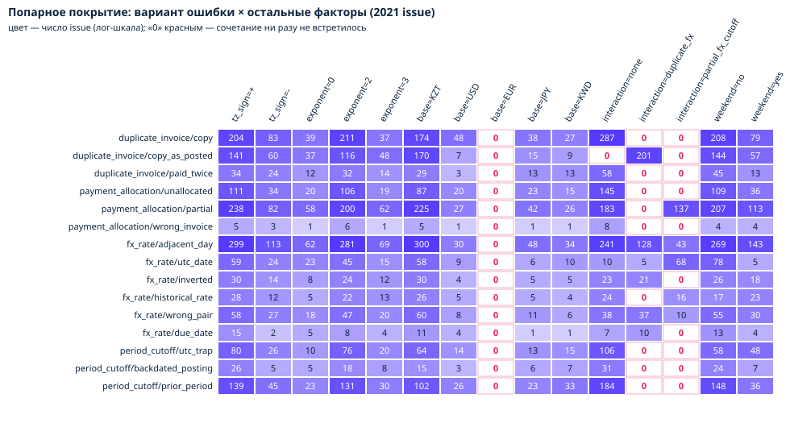

# Карта попарного покрытия генератора

Сгенерировано `make coverage-map` (`tools/coverage_map.py`): 1000 seed по 6 открытым конфигам (seed 750000+),
2021 внесённых ошибок. Факторы: вариант ошибки, знак смещения пояса, экспонента валюты документа,
базовая валюта, сценарий взаимодействия, выходной день (местная дата документа).

**Покрыто пар значений: 267 из 312 теоретически возможных** (все пары факторов). Ниже — каждая
непокрытая пара с причиной. Причины проставлены правилами в `tools/coverage_map.py::reason`: «структура» —
сочетание невозможно по определению ошибки или сценария; «генератор» — сознательное ограничение
(`docs/LIMITATIONS.md`, п. 5); «конфиги» — значение не включено в открытые конфиги; иначе — редкость.

| Факторы | Покрыто | Из возможных |
|---|---|---|
| variant × tz_sign | 30 | 30 |
| variant × exponent | 45 | 45 |
| variant × base | 60 | 75 |
| variant × interaction | 25 | 45 |
| variant × weekend | 30 | 30 |
| tz_sign × exponent | 6 | 6 |
| tz_sign × base | 8 | 10 |
| tz_sign × interaction | 6 | 6 |
| tz_sign × weekend | 4 | 4 |
| exponent × base | 12 | 15 |
| exponent × interaction | 9 | 9 |
| exponent × weekend | 6 | 6 |
| base × interaction | 12 | 15 |
| base × weekend | 8 | 10 |
| interaction × weekend | 6 | 6 |

## Ни разу не встретившиеся сочетания

| Факторы | Сочетание | Причина |
|---|---|---|
| variant × base | `duplicate_invoice/copy` × `EUR` | конфиги: базовая валюта EUR не включена ни в один открытый конфиг |
| variant × base | `duplicate_invoice/copy_as_posted` × `EUR` | конфиги: базовая валюта EUR не включена ни в один открытый конфиг |
| variant × base | `duplicate_invoice/paid_twice` × `EUR` | конфиги: базовая валюта EUR не включена ни в один открытый конфиг |
| variant × base | `payment_allocation/unallocated` × `EUR` | конфиги: базовая валюта EUR не включена ни в один открытый конфиг |
| variant × base | `payment_allocation/partial` × `EUR` | конфиги: базовая валюта EUR не включена ни в один открытый конфиг |
| variant × base | `payment_allocation/wrong_invoice` × `EUR` | конфиги: базовая валюта EUR не включена ни в один открытый конфиг |
| variant × base | `fx_rate/adjacent_day` × `EUR` | конфиги: базовая валюта EUR не включена ни в один открытый конфиг |
| variant × base | `fx_rate/utc_date` × `EUR` | конфиги: базовая валюта EUR не включена ни в один открытый конфиг |
| variant × base | `fx_rate/inverted` × `EUR` | конфиги: базовая валюта EUR не включена ни в один открытый конфиг |
| variant × base | `fx_rate/historical_rate` × `EUR` | конфиги: базовая валюта EUR не включена ни в один открытый конфиг |
| variant × base | `fx_rate/wrong_pair` × `EUR` | конфиги: базовая валюта EUR не включена ни в один открытый конфиг |
| variant × base | `fx_rate/due_date` × `EUR` | конфиги: базовая валюта EUR не включена ни в один открытый конфиг |
| variant × base | `period_cutoff/utc_trap` × `EUR` | конфиги: базовая валюта EUR не включена ни в один открытый конфиг |
| variant × base | `period_cutoff/backdated_posting` × `EUR` | конфиги: базовая валюта EUR не включена ни в один открытый конфиг |
| variant × base | `period_cutoff/prior_period` × `EUR` | конфиги: базовая валюта EUR не включена ни в один открытый конфиг |
| variant × interaction | `duplicate_invoice/copy` × `duplicate_fx` | структура: дубль в duplicate_fx — вариант copy_as_posted (копия, проведённая по неверному курсу) |
| variant × interaction | `duplicate_invoice/copy` × `partial_fx_cutoff` | структура: сценарий partial_fx_cutoff состоит из fx_rate + payment_allocation |
| variant × interaction | `duplicate_invoice/copy_as_posted` × `none` | структура: copy_as_posted бывает только внутри сценария duplicate_fx |
| variant × interaction | `duplicate_invoice/copy_as_posted` × `partial_fx_cutoff` | структура: сценарий partial_fx_cutoff состоит из fx_rate + payment_allocation |
| variant × interaction | `duplicate_invoice/paid_twice` × `duplicate_fx` | структура: дубль в duplicate_fx — вариант copy_as_posted (копия, проведённая по неверному курсу) |
| variant × interaction | `duplicate_invoice/paid_twice` × `partial_fx_cutoff` | структура: сценарий partial_fx_cutoff состоит из fx_rate + payment_allocation |
| variant × interaction | `payment_allocation/unallocated` × `duplicate_fx` | структура: сценарий duplicate_fx состоит из duplicate_invoice + fx_rate |
| variant × interaction | `payment_allocation/unallocated` × `partial_fx_cutoff` | структура: в partial_fx_cutoff платёж распределён частично (вариант partial) |
| variant × interaction | `payment_allocation/partial` × `duplicate_fx` | структура: сценарий duplicate_fx состоит из duplicate_invoice + fx_rate |
| variant × interaction | `payment_allocation/wrong_invoice` × `duplicate_fx` | структура: сценарий duplicate_fx состоит из duplicate_invoice + fx_rate |
| variant × interaction | `payment_allocation/wrong_invoice` × `partial_fx_cutoff` | структура: в partial_fx_cutoff платёж распределён частично (вариант partial) |
| variant × interaction | `fx_rate/inverted` × `partial_fx_cutoff` | генератор: вариант inverted запрещён в partial_fx_cutoff (FAILURES п. 10) |
| variant × interaction | `fx_rate/historical_rate` × `duplicate_fx` | не выпало на этой выборке (редкое сочетание) |
| variant × interaction | `fx_rate/due_date` × `partial_fx_cutoff` | не выпало на этой выборке (редкое сочетание) |
| variant × interaction | `period_cutoff/utc_trap` × `duplicate_fx` | структура: сценарий duplicate_fx состоит из duplicate_invoice + fx_rate |
| variant × interaction | `period_cutoff/utc_trap` × `partial_fx_cutoff` | структура: сценарий partial_fx_cutoff состоит из fx_rate + payment_allocation |
| variant × interaction | `period_cutoff/backdated_posting` × `duplicate_fx` | структура: сценарий duplicate_fx состоит из duplicate_invoice + fx_rate |
| variant × interaction | `period_cutoff/backdated_posting` × `partial_fx_cutoff` | структура: сценарий partial_fx_cutoff состоит из fx_rate + payment_allocation |
| variant × interaction | `period_cutoff/prior_period` × `duplicate_fx` | структура: сценарий duplicate_fx состоит из duplicate_invoice + fx_rate |
| variant × interaction | `period_cutoff/prior_period` × `partial_fx_cutoff` | структура: сценарий partial_fx_cutoff состоит из fx_rate + payment_allocation |
| tz_sign × base | `+` × `EUR` | конфиги: базовая валюта EUR не включена ни в один открытый конфиг |
| tz_sign × base | `-` × `EUR` | конфиги: базовая валюта EUR не включена ни в один открытый конфиг |
| exponent × base | `0` × `EUR` | конфиги: базовая валюта EUR не включена ни в один открытый конфиг |
| exponent × base | `2` × `EUR` | конфиги: базовая валюта EUR не включена ни в один открытый конфиг |
| exponent × base | `3` × `EUR` | конфиги: базовая валюта EUR не включена ни в один открытый конфиг |
| base × interaction | `EUR` × `none` | конфиги: базовая валюта EUR не включена ни в один открытый конфиг |
| base × interaction | `EUR` × `duplicate_fx` | конфиги: базовая валюта EUR не включена ни в один открытый конфиг |
| base × interaction | `EUR` × `partial_fx_cutoff` | конфиги: базовая валюта EUR не включена ни в один открытый конфиг |
| base × weekend | `EUR` × `no` | конфиги: базовая валюта EUR не включена ни в один открытый конфиг |
| base × weekend | `EUR` × `yes` | конфиги: базовая валюта EUR не включена ни в один открытый конфиг |

## Итог по причинам

| Причина | Пар |
|---|---|
| конфиги | 25 |
| структура | 17 |
| не выпало на этой выборке (редкое сочетание) | 2 |
| генератор | 1 |
